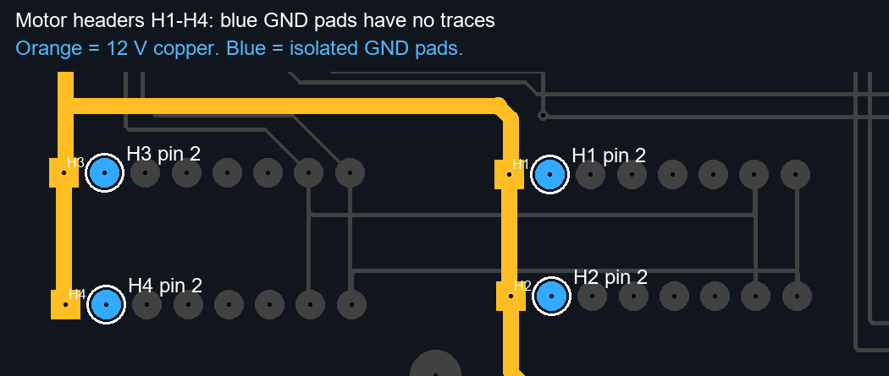

# 底板 Gerber 检查结果

检查对象：`Gerber_PCB1_2026-10-21`，导出时间为2026-10-21 20:24:12。
这是对提供文件的检查；只有实板确实按这套铜层生产且没有外部补线时，才能把结论直接用于实板。

## 最高优先级：GND未布通

- 顶层、底层文件均写明 `Copper Areas: 0`，文件内也没有铺铜区域图元。
- 使用飞针测试文件确定GND焊盘，结合顶、底层铜几何及金属化钻孔检查。
- 去除重复测试点后，共30个GND物理焊盘，分属30个独立铜连通区域。
- 每个区域仅包含该通孔上下两面的焊盘，没有任何GND走线。
- 四轮电机：H1、H2、H3、H4的2脚分别孤立，彼此及核心板GND在底板铜层中不通。
- 机械臂：H5、H6的2脚也分别孤立。
- 电源接口：H13～H17、H19～H21的2脚分别孤立。
- 核心板：U1的13、14脚及U2的1～4脚在底板上也没有GND互连；核心板内部可能另有连接，但不能代替底板对外设的地连接。

该问题能够造成缺少电源回流/串口参考地。外部电源、USB或其他线束若形成偶然回路，
可能出现部分能工作、运动时随机通信失败等现象。仅凭导出文件不能证明实车当前是否有外部共地路径。

## 已检查的其他项目

- H1～H4第7脚互通，并连至U1第45脚；第8脚互通，并连至U1第48脚。原理图将这两组用于PB14 TX/PB15 RX。
- 12V网络连通H13/H14与H1～H6的第1脚；电源正极有铜连接不代表负极已接通。
- 12V、3.3V、+5V、8.4V电源走线宽度均为1.0mm。载流是否足够，需铜厚、实际电流和允许温升，不能仅凭线宽判定。
- 串口等信号走线宽度为0.254mm。
- 此次几何检查没有发现不同网名铜区域相互接触。该结果不能代替EDA完整DRC和实板短路测试。
- 检出的最小不同连通区域铜间距约0.152mm；应按实际板厂能力运行DRC，不据此认定短路。

## 建议的修复与复核顺序

1. 在EDA中检查GND飞线。给GND建立实际走线/铜面，并重新计算铺铜，检查孤岛及跨层地连接。
2. 电机大电流回流需按总电流设计，避免通过主控细信号地回流。不要仅添加一条细地线承载所有驱动电流。
3. 运行DRC，确认GND及其他应连接网络无未连接项，再重新导出Gerber核查实际铜层。
4. 实板断电，断开USB、外设和电源，先短接表笔记录引线电阻，再测H1～H4第2脚到核心板GND及电源负极接口的电阻。
5. 若实板不通，修复地回路后再进行运动通信测试。若实板已通，说明版本或外部连接不同，继续定位供电及原始回包。

## 分析方法及文件

`review_gerber.py`仅处理此导出使用的直线、圆/矩形焊盘及金属化通孔，
进行几何连通分析；没有向原Gerber或固件写入任何修改。
焊盘网名来自 `FlyingProbeTesting.json`；需要EDA源工程确认设计意图。

- `power_ground.png`：按网名着色的铜层图，蓝色为GND，橙色12V，绿色3.3V，粉色+5V，紫色8.4V。
- `copper_overlay.png`：顶层红色、底层蓝色。
- `geometry_analysis.json`：完整几何、连通区域、焊盘映射与间距结果。
