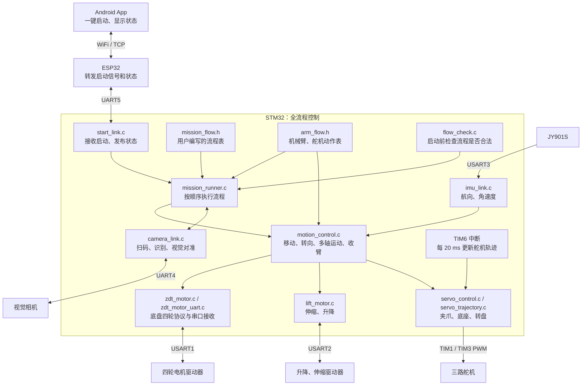

# 当前代码架构

App 一键启动，ESP32 转发启动和状态，STM32 按 `mission_flow.h` 执行完整流程。

## 模块关系

## 执行方式

1. App 发送 `START,<编号>\n`，ESP32 转发给 STM32。
2. `StartLink_Service()` 接收并检查命令，将任务编号记入 `pending`。
3. 主循环调用 `StartLink_Tick()`，进入 `MissionRunner_Run()`。
4. 启动前调用 `Flow_Check()` 校验流程表，通过后用 `for + switch` 顺序执行各项操作。
5. 显式 `FLOW_ALIGN()` 完成视觉对准并记录位移；站点执行三件物料取放，收臂后 `FLOW_UNALIGN()` 抵消校准净位移。状态经 ESP32 返回 App。

`mission_flow.h` 在编译时形成 `mission_flow[]` 结构体数组，运行时直接读取数组。编写方法见 [流程编写约定](FLOW_AUTHORING.md)。

总流程支持 `FLOW_ARM(动作数组名)`：引用 `arm_flow.h` 中自定义的 `ArmStep` 数组，由 `ArmFlow_Run()` 依次执行整组小动作后继续总流程。原有取放站点宏仍可使用；自定义动作组可以重复嵌入，不自动视觉对准或更新批次计数。

动作格式及宏在 `arm_types.h`，执行循环位于 `App/Src/arm_flow.c`，`arm_flow.h` 只保留可编辑动作。流程校验只检查格式、参数及参考/扫码前置条件，不限制批次、站点先后或重复次数。TIM1/TIM3 由 CubeMX 初始化一次，舵机模块绑定同一组句柄，并管理 TIM6 轨迹时钟。

机械臂动作组可用 `ARM_AREA()` 显式选择原料/加工/暂存/码垛区，再用 `ARM_TO_PICK()` / `ARM_TO_PUT()` 使用当前区域的左中右姿态。区域声明只在本次动作组执行期间有效；直接坐标动作保持原值。

默认取放和自定义动作使用同一套区域位置执行路径，码垛加高仅在放置位处理。收臂在动作层 `ArmFlow_Stow()` 编排，运动层不调用动作执行器；`Motion_Radial()` 仅提供当前伸缩逻辑位置。校验只要求转向前建立 IMU 参考，其他动作不依赖 IMU。

## 运动与并行

- 底盘四轮的位置命令同步触发，按预计运动时间等待。
- `Motion_MoveAll()` 依次发出伸缩、升降、底座命令，执行器并行运行，等待三者预计耗时的最大值。
- 舵机由 TIM6 中断持续更新五次曲线轨迹，前台等待期间仍能运动。
- 转向读取 IMU 航向和角速度，以 PD 控制等待姿态稳定。样本无效时先停四轮，再等待有效数据恢复并重新计时稳定窗口；保留累计航向，不在恢复时重置已转圈数。
- 动作等待期间继续调用 `StartLink_Service()`，处理启动通信、相机和 IMU 数据；只有主循环调用 `StartLink_Tick()`，避免递归启动任务。

## 视觉对准

粗调收到明确的 `NONE` 后，按“前移 100 → 后移 100 → 左移 50 → 右移 50 mm”循环搜索，到达每个目标点后重新识别，找到目标就结束搜索。每个站点从前移开始，每轮结束停在起点右侧50 mm，下一轮仍使用原起点。

每次粗调请求先留出 1500 ms 识别窗口，窗口后收到新的 `NONE` 才移动；相机没有回复时继续等待。取得坐标后粗调一次，再重新识别精调一次；每次先修正车体前后轴，再修正左右轴。

## 当前边界

- App 只有启动操作和状态显示；ESP32 负责通信转发。
- 步进保留命令应答，运动完成主要按预计时间判断，没有实际到位轮询或多轴反馈完成屏障。
- 没有动作、视觉或搜索总超时；相机无回复、精调无有效目标或转向未稳定时会持续等待。
- 命令执行失败时退出本轮并发送一次停车指令。
- 机械臂依赖约定的上电初始姿态，没有编码器建零或限位回零。

## 修改入口

| 需要修改的内容 | 文件 |
|---|---|
| 路线和站点顺序 | `stm32/yundongv2/App/Inc/mission_flow.h` |
| 流程操作类型及宏 | `stm32/yundongv2/App/Inc/flow_types.h` |
| 流程合法性规则 | `stm32/yundongv2/App/Src/flow_check.c` |
| 站点姿态、取放和收臂动作 | `stm32/yundongv2/App/Inc/arm_flow.h` |
| 距离标定、视觉方向、搜索距离 | `stm32/yundongv2/App/Inc/mission_config.h` |
| 默认运动速度 | `stm32/yundongv2/App/Inc/motion_speed.h` |

